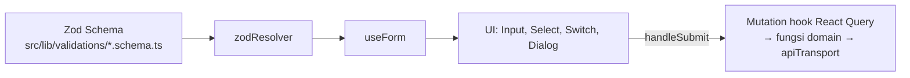

# Kumpul Cafe Frontend System Architecture Specification

> **Project**: Kumpul Cafe – Digital QR Code Menu System & Progressive Web App (PWA)  
> **Brand Name**: Kumpul Cafe  
> **Backend Integration**: NestJS 11 (`http://localhost:5000/api/v1`)  
> **Framework**: Next.js 16 (App Router, TypeScript) + React 19  
> **Styling**: Tailwind CSS v4  
> **State Management**: Zustand (Auth, Handshake Session, Sidebar, PWA; Cart & Table untuk fase QR publik)  
> **Data Fetching & Cache**: `@tanstack/react-query` (v5) + `apiTransport` & Interceptor Pipeline  
> **Real-Time**: Polling React Query (KDS setiap 10 detik). `socket.io-client` sudah terpasang tapi belum dipakai.  
> **Security Standard**: WebCrypto API (P-256 ECDH + AES-256-GCM payload encryption, di atas TLS)  
> **Document Location**: `docs/fe/architecture/architecture-design.md`  
> **Status**: Disinkronkan dengan kode pada 2026-11-20  

---

## 🏛️ 1. Architectural Pattern & Design Principles

Frontend **Kumpul Cafe** memakai **Domain-First Modular Component Architecture** di atas **Next.js App Router**, dengan enkripsi payload dan kontrol akses berbasis role.

### Prinsip Utama:
1. **Domain-First Component Architecture**:
   - Komponen UI dikelompokkan berdasarkan **domain bisnis** (`orders/`, `tables/`, `menus/`, `staff/`, `attendance/`, `kiosk/`, …), bukan berdasarkan role.
   - Komponen bersama seperti `OrdersView` (Admin & Dapur) dan `TablesView` (Admin, Kasir, Pelayan) netral dan tidak terkunci di folder admin.
   - Setiap folder domain punya **barrel export (`index.ts`)**.
2. **Server vs. Client Component Boundaries**:
   - **Server Components**: root layout, metadata.
   - **Client Components (`'use client'`)**: hampir semua halaman dashboard, karena memakai Zustand, React Query, WebCrypto, dan form. Shell dashboard dirender setelah hydration (`AuthGuard`).
3. **Interceptor Pipeline & Payload Encryption**:
   - Request lewat `apiTransport` → `executePipeline` (`loggerMiddleware` → `authMiddleware` → `handshakeMiddleware` → `encryptionMiddleware`). Detail: [interceptor-pipeline-architecture.md](./interceptor-pipeline-architecture.md).
4. **Type-Safe Role-Based Access Control (RBAC)**:
   - Konstanta `ROLE`, `ROLE_GROUPS`, dan helper `getRoleHomePath()` di `src/lib/constants/roles.ts`.
   - `<AuthGuard>` (login + karantina onboarding) dan `<RoleGuard>` (izin per halaman).
   - ⚠️ Proteksi rute saat ini **hanya di sisi client**; belum ada `proxy.ts`. Backend tetap wajib memvalidasi role pada setiap endpoint.
5. **Data Real-Time**:
   - KDS memakai polling React Query (`use-admin-orders.ts`, interval 10 detik). WebSocket direncanakan untuk fase order tracking pelanggan (roadmap Phase 3).

---

## 📁 2. Directory Structure (`src/`)

```text
src/
├── app/                              # Next.js App Router
│   ├── (auth)/login/page.tsx         # /login — login staf (satu pintu untuk semua role)
│   ├── (public)/layout.tsx           # Shell mobile pelanggan (halaman QR publik belum dibuat)
│   ├── (dashboard)/                  # Portal internal (AuthGuard + RoleGuard)
│   │   ├── layout.tsx                # Shell: CommonHeader + CommonSidebar + CommonBottomNav
│   │   ├── not-found.tsx
│   │   ├── admin/
│   │   │   ├── dashboard/            # Ringkasan omset
│   │   │   ├── reports/              # Laporan penjualan + ekspor
│   │   │   ├── menus/                # list, create, edit/[id], detail/[id]
│   │   │   ├── categories/
│   │   │   ├── tables/
│   │   │   ├── orders/
│   │   │   ├── banners/              # list, create, edit/[id]
│   │   │   ├── shifts/               # Buka/tutup shift kasir, Z-Report
│   │   │   ├── attendance/           # Monitoring presensi, lembur, koreksi
│   │   │   ├── staff/                # Akun staf, PIN, kredensial
│   │   │   └── settings/             # index + branch/, policies/, shifts/ (template shift)
│   │   ├── cashier/
│   │   │   ├── tables/               # Workstation kasir
│   │   │   └── kiosk/                # Mode kiosk presensi di meja kasir
│   │   ├── kitchen/orders/           # Kitchen Display System (KDS)
│   │   └── waiter/tables/            # Denah meja pelayan
│   ├── onboarding/page.tsx           # Ganti password + buat PIN saat login pertama
│   ├── test/                         # Test halaman
│   ├── layout.tsx                    # Root layout + providers
│   ├── not-found.tsx                 # 404 global
│   └── page.tsx                      # Landing
│
├── components/                       # Komponen per domain (+ index.ts)
│   ├── attendance/                   # ClockInModal, tabel & filter presensi, lembur, cuti, koreksi
│   ├── banners/                      # Form, kartu, uploader, PromoCarousel
│   ├── common/                       # AuthGuard, RoleGuard, shell, dialog, pagination, breadcrumb, …
│   ├── illustrations/                # SVG animasi (cangkir kopi 404)
│   ├── kiosk/                        # CashierKioskView, grid staf, PIN modal, exit dialog, overlay
│   ├── menus/                        # MenuForm, tabel/kartu menu, filter, kategori
│   ├── orders/                       # OrdersView (KDS/log), kartu pesanan, struk
│   ├── reports/                      # KPI, top selling, breakdown status, ekspor
│   ├── settings/                     # Form cabang + peta geofence, kebijakan toko, template shift
│   ├── shifts/                       # Buka/tutup shift, handover, riwayat, Z-Report
│   ├── staff/                        # Tabel & form staf, PIN, kredensial
│   ├── tables/                       # TablesView, modal meja/zona/QR/reset
│   ├── ui/                           # Primitif (button, dialog, select, AppImage, …)
│   └── test/<domain>/                # Test komponen, simetris dengan folder domain
│
├── hooks/
│   ├── queries/use-admin-*.ts        # Hook React Query per domain
│   ├── use-unsaved-changes-guard.ts  # Peringatan perubahan belum disimpan
│   └── test/
│
├── lib/
│   ├── api/                          # Lihat interceptor-pipeline-architecture.md
│   │   ├── api-transport.ts          # apiTransport (alias: hardenedFetch)
│   │   ├── pipeline/                 # executePipeline + 4 middleware
│   │   ├── handshake-session.ts      # Handshake ECDH
│   │   ├── mock-fallback.ts          # Gate fallback mock (dev saja)
│   │   ├── either.ts, api-error.ts, error-codes.ts, error-translator.ts, notify-error.ts
│   │   └── *-api.ts                  # Fungsi per domain
│   ├── constants/                    # roles.ts, navigation.ts, attendance.ts, branch-settings.ts
│   ├── crypto/ecdh.ts                # ECDH P-256 + HKDF + AES-256-GCM
│   ├── pwa/register-sw.ts            # Registrasi service worker (production saja)
│   ├── validations/*.schema.ts       # Schema Zod per domain
│   ├── utils/                        # Rupiah, tanggal, haversine, parser gmaps, geocoding, audio, …
│   ├── logger.ts                     # Pino (browser production: mati)
│   ├── query-keys.ts                 # Factory query key terpusat
│   └── test/
│
├── providers/                        # Query, theme, toaster, handshake, PWA
├── store/                            # Zustand: auth (persist), handshake (RAM), sidebar, pwa, theme, cart, table
├── test/                             # Setup Vitest, handler MSW, renderWithProviders
└── types/                            # Tipe bersama (pagination)
```

---

## 🔒 3. Role Access Strategy (`src/lib/constants/roles.ts`)

```typescript
export const ROLE = {
  ADMIN: 'ADMIN',
  CASHIER: 'CASHIER',
  KITCHEN: 'KITCHEN',
  WAITER: 'WAITER',
  // Sinonim yang bisa dikirim backend
  KASIR: 'KASIR',
  DAPUR: 'DAPUR',
  PELAYAN: 'PELAYAN',
} as const;

export const ROLE_GROUPS = {
  ADMIN_ONLY: [ROLE.ADMIN],
  CASHIER_OR_ADMIN: [ROLE.ADMIN, ROLE.CASHIER, ROLE.KASIR],
  // Catatan: kasir juga termasuk, sehingga kasir bisa membuka KDS. Perlu dikonfirmasi apakah disengaja.
  KITCHEN_OR_ADMIN: [ROLE.ADMIN, ROLE.KITCHEN, ROLE.DAPUR, ROLE.CASHIER, ROLE.KASIR],
  WAITER_OR_ADMIN: [ROLE.ADMIN, ROLE.WAITER, ROLE.PELAYAN],
  ALL_STAFF: ALL_ROLES, // ketujuh nilai di atas
} as const;
```

**Halaman awal per role** — selalu pakai `getRoleHomePath(role)`, jangan menulis ulang `switch`:

| Role | Halaman |
| :--- | :--- |
| `ADMIN` | `/admin/dashboard` |
| `CASHIER` / `KASIR` | `/cashier/tables` |
| `KITCHEN` / `DAPUR` | `/kitchen/orders` |
| `WAITER` / `PELAYAN` | `/waiter/tables` |
| (belum login) | `/login` |

Dipakai oleh halaman login, onboarding, `AuthGuard`, `RoleGuard`, dan breadcrumb.

---

## 📝 4. Standard Form & Validation Architecture (`react-hook-form` + `zodResolver`)



### Prinsip:
1. **Single Source of Truth**: aturan validasi, default value, dan pesan error didefinisikan di schema Zod (`src/lib/validations/`).
2. **Tanpa `useState` ad-hoc untuk field form**: gunakan `useForm<T>({ resolver: zodResolver(schema) })`.
3. **Error inline per field** via `formState.errors.<field>?.message`.
4. **Simpan lewat mutation hook** (`useCreate…Mutation`, `useUpdate…Mutation`), bukan memanggil fungsi API langsung, supaya cache React Query ikut diinvalidasi.

---

## 🔗 5. Dokumen Terkait

- 📘 [frontend-development-handbook.md](../guidelines/frontend-development-handbook.md): aturan & resep
- 📄 [interceptor-pipeline-architecture.md](./interceptor-pipeline-architecture.md): transport & middleware
- 📄 [api-endpoints.md](../integration/api-endpoints.md): daftar endpoint
- 📄 [cafe-branch-operational-blueprint.md](./cafe-branch-operational-blueprint.md): kebutuhan operasional cabang
- 📄 [client-crypto-strategy.md](../security/client-crypto-strategy.md): handshake ECDH
- 📄 [implementation-milestones.md](../roadmap/implementation-milestones.md): roadmap
