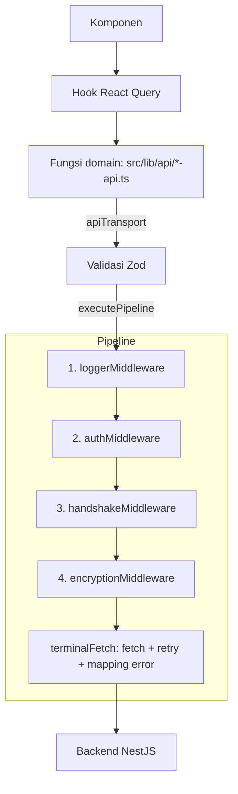
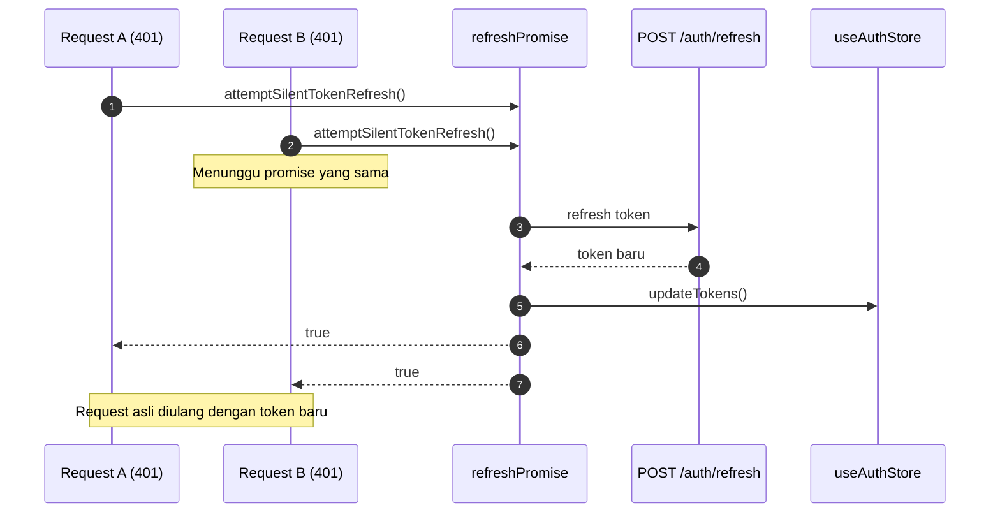

# Interceptor Middleware Pipeline & API Transport

> **Scope**: Next.js 16 Frontend API Client Layer  
> **Source Code Location**: `src/lib/api/api-transport.ts` & `src/lib/api/pipeline/`  
> **Document Location**: `docs/fe/architecture/interceptor-pipeline-architecture.md`  
> **Status**: Sesuai kode per 2026-11-20 (ditulis ulang setelah refactor 2-layer; nama lama `customFetch` / `hardened-fetch.ts` sudah tidak ada)

---

## 🎯 1. Overview

Frontend **Kumpul Cafe** tidak memakai Axios. Semua request ke backend lewat **dua lapis** di atas `fetch` bawaan browser:

| Lapis | File | Tanggung jawab |
| :--- | :--- | :--- |
| **1. `apiTransport`** | `src/lib/api/api-transport.ts` | Memanggil pipeline, lalu memvalidasi response dengan schema Zod. Mengembalikan `Either<ApiError, z.infer<Schema>>`. `hardenedFetch` hanyalah alias lama untuk fungsi ini. |
| **2. `executePipeline`** | `src/lib/api/pipeline/pipeline-runner.ts` | Menjalankan middleware secara berurutan (pola *onion*), melakukan `fetch`, menangani retry handshake & refresh token, dan mengubah error HTTP menjadi `ApiError`. |

Fungsi domain di `src/lib/api/*-api.ts` memanggil `apiTransport`; hook React Query di `src/hooks/queries/` memanggil fungsi domain tersebut. Komponen tidak pernah memanggil `fetch` langsung.



---

## 📁 2. Struktur File

```text
src/lib/api/
├── api-transport.ts          # Lapis 1: pipeline + validasi Zod (alias: hardenedFetch)
├── pipeline/
│   ├── pipeline-runner.ts    # Lapis 2: executePipeline, terminalFetch, mutex refresh token
│   ├── logger-middleware.ts  # Log request/response + latency (dev saja di browser)
│   ├── auth-middleware.ts    # Header Authorization: Bearer <accessToken>
│   ├── handshake-middleware.ts # Header x-handshake-token + ctx.sessionKey
│   ├── encryption-middleware.ts # Enkripsi body / dekripsi response AES-256-GCM
│   └── types.ts              # PipelineContext, Middleware, NextFunction
├── handshake-session.ts      # performHandshake / ensureHandshakeSession (ECDH)
├── types.ts                  # ApiTransportOptions
├── either.ts                 # Either<L, R>, left(), right()
├── api-error.ts              # Kelas ApiError
├── error-codes.ts            # Enum ErrorCode + mapping dari status HTTP
├── error-translator.ts       # Pesan error ramah pengguna (Bahasa Indonesia)
├── notify-error.ts           # notifyApiError → toast Sonner
├── mock-fallback.ts          # Gate fallback mock localStorage (dev saja)
└── *-api.ts                  # Fungsi per domain (menu, staf, shift, presensi, …)
```

Daftar lengkap endpoint ada di [api-endpoints.md](../integration/api-endpoints.md).

---

## ⚙️ 3. Opsi Request (`ApiTransportOptions`)

`ApiTransportOptions` adalah `RequestInit` (tanpa `body`) ditambah:

| Opsi | Default | Efek |
| :--- | :--- | :--- |
| `body` | — | Objek JS (otomatis di-`JSON.stringify`), string, atau `FormData`. |
| `skipHandshakeToken` | `false` | Lewati handshake. Tanpa session key, **body dan response juga tidak dienkripsi**. Dipakai untuk login, refresh, onboarding, dan endpoint `/public/*`. |
| `skipEncryption` | `false` | Tetap lakukan handshake, tetapi kirim body apa adanya. Dipakai untuk upload `FormData`. |
| `retryOnHandshakeExpired` | `true` | Saat backend membalas error handshake, lakukan handshake ulang lalu ulangi request sekali. |
| `retryOnTokenExpired` | `true` | Saat backend membalas 401, coba refresh token lalu ulangi request sekali. |

> Tidak ada opsi `skipAuth`. Header `Authorization` selalu ditambahkan jika ada token, kecuali pemanggil sudah mengisinya sendiri. Ini termasuk `/auth/refresh` dan `/auth/logout`: keduanya `@Public()` dan membaca cookie, jadi backend mengabaikan Bearer (yang mungkin sudah kedaluwarsa).
>
> `credentials: 'include'` (opsi standar `fetch`, diteruskan oleh `pipeline-runner.ts`) dipakai endpoint yang menerima atau memakai cookie refresh: login, onboard, handover, refresh, logout. Kelima request itu juga berjalan di dalam Web Lock `menuscan-refresh` (`src/lib/api/auth-cookie-lock.ts`), sehingga di semua tab hanya satu yang mengubah cookie pada satu waktu.

---

## 🔍 4. Rincian Middleware

### `PipelineContext` (`types.ts`)

```typescript
export interface PipelineContext<T = unknown> {
  url: string;
  method: string;
  headers: Record<string, string>;
  body?: unknown;
  options: ApiTransportOptions;
  sessionKey?: CryptoKey | null;
  rawResponse?: Response;
  responseData?: T;
  startTime?: number;
  durationMs?: number;
}
```

### 1. `loggerMiddleware`
- Mencatat method, URL, query, body (untuk POST/PUT/PATCH/DELETE), status, dan latency.
- Field `password` dan `refreshToken` disamarkan; logger pino juga me-redact token & kunci.
- Di browser **production, log dimatikan total**. Di development log tampil di DevTools.
- Catatan: `currentPassword`, `newPassword`, dan `pinCode` belum disamarkan di log development.

### 2. `authMiddleware`
- Mengambil `accessToken` dari `useAuthStore`. Jika store belum selesai rehydrate, membaca langsung dari `localStorage` (`kumpul_cafe_auth`).
- Menambahkan `Authorization: Bearer <token>` jika belum ada header Authorization.

### 3. `handshakeMiddleware`
- Jika `skipHandshakeToken` tidak aktif, memanggil `ensureHandshakeSession()`: memakai session key di memori bila belum kedaluwarsa, atau melakukan handshake ECDH baru.
- Menambahkan header `x-handshake-token` dan mengisi `ctx.sessionKey`.
- Session key hanya disimpan di memori (Zustand tanpa persist), hilang saat reload.

### 4. `encryptionMiddleware`
- **Sebelum fetch**: jika ada `body`, ada `sessionKey`, dan `skipEncryption` tidak aktif, body dienkripsi menjadi:
  ```json
  { "encrypted": true, "iv": "<base64>", "tag": "<base64>", "payload": "<base64>" }
  ```
  Jika tidak dienkripsi, objek di-`JSON.stringify` (kecuali `FormData`).
- **Setelah fetch**: jika response berbentuk envelope di atas, didekripsi dengan session key yang sama. Gagal dekripsi → `ApiError` dengan kode `DECRYPTION_FAILED`.

### `terminalFetch` (di `pipeline-runner.ts`)
1. Menjalankan `fetch`, lalu mem-parse JSON (jika gagal, dianggap `null`).
2. **Error handshake** (400/401 dengan kata "handshake" di `message`/`error`, atau `code === 'HANDSHAKE_FAILED'`) → handshake ulang + ulangi request sekali.
3. **401 di luar `/auth/login` dan `/auth/refresh`** → refresh token (lihat §5), lalu ulangi request sekali.
4. Status non-2xx lain → `ApiError(statusCode, error, message, { details })`.
5. Sukses → `responseData = json.data` jika ada, selain itu `json` utuh.

Error jaringan (fetch gagal) menjadi `ApiError.networkError()` dengan `statusCode` 0.

---

## ⚡ 5. Refresh Token dengan Single-Flight Mutex

Saat beberapa request paralel mendapat 401 bersamaan, hanya **satu** panggilan `POST /auth/refresh` yang dikirim; request lain menunggu promise yang sama (`refreshPromise`).



Refresh memakai cookie HttpOnly `menuscan_rt` (`POST /auth/refresh` dengan body `{}` dan `credentials: 'include'`). JavaScript tidak bisa melihat cookie itu, jadi refresh hanya dicoba jika ada `user` di store. Karena semua tab berbagi satu cookie dan setiap refresh merotasinya, refresh dijalankan di dalam Web Lock `menuscan-refresh` (`navigator.locks`), sehingga tab kedua memakai cookie yang baru diterima tab pertama. Tanpa Web Locks, refresh yang `401` dicoba ulang sekali setelah 300 ms. Hasil refresh dibuang jika `user` di store berganti selama refresh (mis. serah terima shift).

Jika refresh gagal:
- Masih ada `user` di store → buka **modal login ulang** (`SessionExpiredModal`) supaya pekerjaan di halaman tidak hilang.
- Tidak ada `user` → `logout()` lalu redirect ke `/login`.

> Handshake ECDH juga **single-flight**: `performHandshake()` menyimpan promise handshake yang sedang berjalan, dan request paralel (misalnya saat halaman baru dibuka) menunggu promise yang sama. Setelah selesai, berhasil atau gagal, promise itu dilepas sehingga handshake berikutnya bisa dimulai.

---

## 🛡️ 6. Validasi Kontrak dengan Zod (`api-transport.ts`)

```typescript
export async function apiTransport<TSchema extends z.ZodTypeAny>(
  endpoint: string,
  schema: TSchema,
  options: ApiTransportOptions = {}
): Promise<Either<ApiError, z.infer<TSchema>>> {
  const rawResult = await executePipeline<unknown>(endpoint, options);
  if (rawResult.isLeft()) return left(rawResult.value);

  const parseResult = schema.safeParse(rawResult.value);
  if (!parseResult.success) {
    // log issue + ApiError.contractViolation(endpoint, details)
  }
  return right(parseResult.data);
}
```

Response yang tidak sesuai schema tidak pernah sampai ke UI; hasilnya `Left` dengan kode `CONTRACT_VIOLATION`.

---

## 🧪 7. Fallback Mock untuk Development

Modul staf dan shift (`admin-staff-api.ts`, `admin-shifts-api.ts`) punya data tiruan di `localStorage` untuk development tanpa backend.

- **Mati secara default.** Aktifkan dengan `NEXT_PUBLIC_ENABLE_MOCK_FALLBACK=true` di `.env.local`.
- Saat aktif, hanya dipakai untuk error **jaringan (0), 404, dan 501**. Error 400/401/403/409/5xx selalu diteruskan ke UI.
- Jangan pernah mengaktifkannya di production: UI akan menampilkan "berhasil" untuk data yang tidak pernah tersimpan di server.

---

## 🔐 8. Catatan Keamanan

- Enkripsi payload melindungi isi request dari inspeksi biasa, tetapi **bukan pengganti TLS**: `NEXT_PUBLIC_APP_SECRET` (salt HKDF) ikut terkirim ke browser, dan public key server tidak diautentikasi. Perlindungan utama tetap HTTPS.
- Login, refresh, dan onboarding memakai `skipHandshakeToken`, jadi password dan PIN di endpoint tersebut hanya dilindungi TLS.
- Refresh token ada di cookie HttpOnly `menuscan_rt` dan tidak bisa dibaca JavaScript. Access token (berlaku ~15 menit) dan profil user masih di `localStorage`, jadi XSS tetap bisa memakai access token selama masa berlakunya; menyimpannya hanya di memori ada di luar cakupan migrasi ini.

---

## 🔗 9. Dokumen Terkait
- [api-endpoints.md](../integration/api-endpoints.md): daftar endpoint yang dipakai frontend
- [client-crypto-strategy.md](../security/client-crypto-strategy.md): detail handshake ECDH
- [frontend-development-handbook.md](../guidelines/frontend-development-handbook.md): resep menambah endpoint & hook
