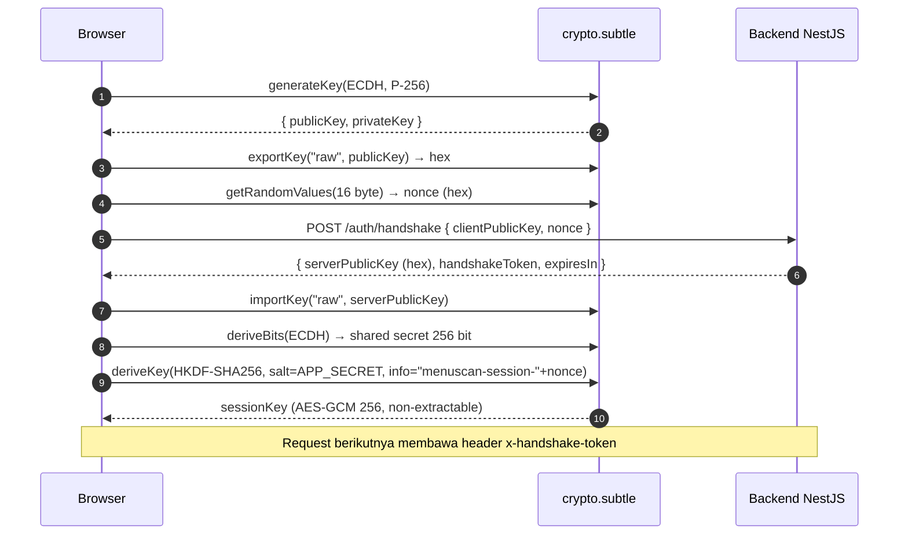

# Client-Side Payload Encryption & ECDH Handshake Strategy

> **Document Status**: Disinkronkan dengan kode pada 2026-11-20 (`src/lib/crypto/ecdh.ts`, `src/lib/api/handshake-session.ts`)  
> **Scope**: Next.js (Frontend Client Application)  
> **Backend Base URL**: `NEXT_PUBLIC_API_BASE_URL` (default `http://localhost:5000/api/v1`, NestJS 11)  
> **Security Standard**: Enkripsi payload di application layer via Web Crypto API (P-256 ECDH + HKDF-SHA256 + AES-256-GCM), **di atas TLS**  
> **Document Location**: `docs/fe/security/client-crypto-strategy.md`  

---

## 🎯 1. Overview

Frontend Kumpul Cafe mengenkripsi body request dan response pada **application layer** dengan **AES-256-GCM**. Kunci simetris (*session key*) dibuat di browser lewat **handshake ECDH** dengan backend, memakai Web Crypto API (`crypto.subtle`).

Enkripsi dan dekripsi dilakukan otomatis oleh `encryptionMiddleware` di pipeline API. Cara kerja pipeline dan opsi untuk melewati enkripsi dijelaskan di [interceptor-pipeline-architecture.md](../architecture/interceptor-pipeline-architecture.md).

---

## 🔐 2. Spesifikasi Kriptografi

| Komponen | Spesifikasi | Keterangan |
| :--- | :--- | :--- |
| **Crypto Engine** | `crypto.subtle` | Web Crypto API bawaan browser. |
| **Key Exchange** | **ECDH `P-256`** | Keypair baru dibuat untuk setiap handshake. Public key diekspor `raw` lalu dikirim sebagai **hex**. |
| **Nonce** | 16 byte acak, dikirim sebagai **hex** | Dipakai di parameter `info` HKDF. |
| **Key Derivation** | **HKDF-SHA256** | `salt` = `NEXT_PUBLIC_APP_SECRET` (UTF-8), `info` = `menuscan-session-<nonce>`, input = 256 bit shared secret ECDH. |
| **Symmetric Cipher** | **AES-256-GCM** | IV 12 byte acak per pesan, tag 16 byte. |
| **Session Lifetime** | `expiresIn` dari server (default 7200 detik bila tidak dikirim) | Dianggap kedaluwarsa 30 detik lebih awal, lalu handshake ulang otomatis. |

### Format envelope terenkripsi (request & response)

```json
{
  "encrypted": true,
  "iv": "<base64, 12 byte>",
  "tag": "<base64, 16 byte>",
  "payload": "<base64 ciphertext tanpa tag>"
}
```

---

## 🤝 3. Alur Handshake (`performHandshake`)



### Kapan handshake diulang

- Session key belum ada atau sudah (hampir) kedaluwarsa → `ensureHandshakeSession()` melakukan handshake baru sebelum request.
- Backend membalas **400/401** dengan kata `handshake` di `message`/`error`, atau `code === 'HANDSHAKE_FAILED'` → handshake ulang lalu request diulang **sekali**.

---

## 🔒 4. Penyimpanan Session Key

1. **Memori saja**: `sessionKey` (objek `CryptoKey`, non-extractable) dan `handshakeToken` disimpan di `useHandshakeStore` (Zustand **tanpa** persist). Reload halaman = handshake baru.
2. **Kedaluwarsa ketat**: mengikuti `expiresIn` dari server, dikurangi buffer 30 detik.

---

## ⚠️ 5. Batasan Keamanan (Baca Sebelum Mengandalkan Enkripsi Ini)

- **Bukan pengganti TLS.** `NEXT_PUBLIC_APP_SECRET` adalah variabel `NEXT_PUBLIC_*`, jadi ikut ter-bundle ke browser dan bisa dibaca siapa pun. Kode juga punya nilai fallback hardcoded jika env tidak diisi.
- **Public key server tidak diautentikasi.** Tanpa TLS, pihak di tengah jaringan bisa melakukan handshake sendiri dengan browser (MITM). Perlindungan utama tetap HTTPS.
- **Tidak semua endpoint dienkripsi.** Login, refresh token, onboarding (password + PIN), dan endpoint `/public/*` memakai `skipHandshakeToken`, sehingga hanya dilindungi TLS. Upload file memakai `skipEncryption`.
- Yang diberikan enkripsi ini: payload tidak terbaca di tab Network DevTools atau log proxy biasa, serta setiap pesan punya integritas (GCM tag).

---

## 🔗 6. Dokumen Terkait

- 📄 [interceptor-pipeline-architecture.md](../architecture/interceptor-pipeline-architecture.md): pipeline & opsi transport
- 📄 [api-endpoints.md](../integration/api-endpoints.md): endpoint mana yang dienkripsi
- 📄 [architecture-design.md](../architecture/architecture-design.md): arsitektur frontend
